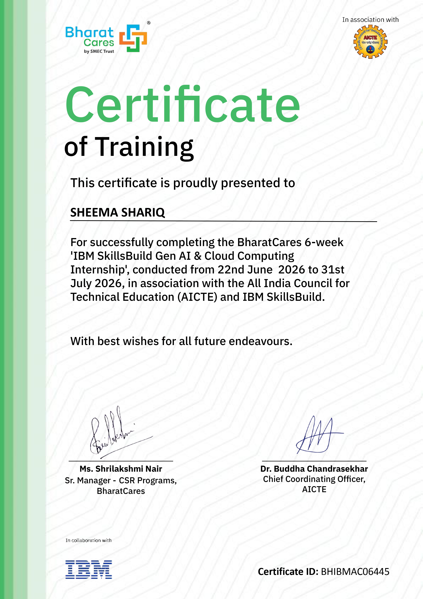

# Exmentify — AI Exam Prep Companion

An exam-agnostic AI study companion. GATE CS is fully built out (10 subjects,
45 topics, 79 seeded previous-year questions); 9 other exams — other GATE
branches (DA, EE, CE, ME, ECE), UGC NET, CSIR NET, CAT, GRE, Campus Placement,
and Bank & SSC — are wired into the architecture as "Coming Soon" to prove the
design generalizes.

## Documentation
- [Project Concept Note](docs/Exmentify_Project_Concept_Note.pdf)
- [Project Report](docs/Exmentify_Project_Report.pdf)

## Live Application

**Primary URL (HTTPS via CloudFront):**
https://d1vcdm3hqyivum.cloudfront.net

**Backend URL (HTTP via AWS Elastic Beanstalk):**
http://sheema-exmentify-app.ap-south-1.elasticbeanstalk.com

*Note: The application is hosted on AWS Elastic Beanstalk. A CloudFront
distribution sits in front of it to serve the app over HTTPS, since Elastic
Beanstalk's default domain cannot issue a valid SSL certificate on its own.
Both URLs are live and point to the same running application.*

**To see live AI-generated responses, click the GATE - Computer Science (CS)
card on the homepage.** The other exam cards are shown as "Coming Soon" to
demonstrate that the application's architecture is exam-agnostic, but only
GATE CS has topics, PYQs, and AI generation fully wired up in this submission.

## Features

- **Explain, Revision Notes, Practice (difficulty-tuned), PYQ Solutions** —
  streamed live from Gemini, token-by-token
- **Ask a Doubt** — an open-ended follow-up chat scoped to the current topic
- **Flashcards** — AI-generated flip cards per topic
- **Diagnose My Mistake** — explains the misconception behind a specific
  wrong answer
- **AI Study Plan** — a day-by-day revision schedule tied to a real exam date
- **Structured Cheat Sheets** — per-subject reference cards
- **Weekly Contest** — student-selected topics, timed, personal (never
  comparative) feedback, with a real 7-day unlock gate and a reschedule
  control that actually moves the unlock date
- **Mermaid diagrams** — rendered inline in Explain responses when a visual
  genuinely helps
- **PDF export** — notes, cheat sheets, PYQ lists, and study plans
- **Study tracking** — streaks, a daily goal ring, bookmarks, and achievement
  badges — all via localStorage, no account or database required
- **4 themes** — Study Lamp, Daylight, Midnight, Sepia

## Project structure

```
exmentify/
├── backend/
│   ├── main.py            # FastAPI app: catalog routes + SSE streaming routes
│   ├── requirements.txt
│   └── data/
│       ├── exams.json
│       ├── subjects.json
│       └── pyqs.json
├── frontend/
│   ├── index.html
│   ├── style.css
│   └── app.js              # vanilla JS, fetch-based SSE parsing, localStorage
├── Dockerfile               # single image, serves API + static frontend
├── .env.example
└── .gitignore
```

## Run locally

```bash
cd exmentify
cp .env.example .env        # then paste your real GEMINI_API_KEY into .env
docker build -t exmentify .
docker run --env-file .env -p 8000:8000 exmentify
```

Open http://localhost:8000. Without a valid `GEMINI_API_KEY`, every AI
endpoint still responds correctly — it streams a graceful SSE `error` event
instead of crashing, so you can verify the whole app end-to-end before wiring
in a key.

### Run without Docker (fastest for iterating)

```bash
cd exmentify/backend
pip install -r requirements.txt --break-system-packages   # or use a venv
export GEMINI_API_KEY=your-key-here
uvicorn main:app --reload --port 8000
```

## Deploy to AWS (Elastic Beanstalk + CloudFront)

This app is deployed via **AWS Elastic Beanstalk** (running the Docker
container) with **AWS CloudFront** in front of it to provide HTTPS, since
Elastic Beanstalk's default domain cannot be issued a valid SSL certificate
on its own.

1. Zip the project folder (`Dockerfile`, `backend/`, `frontend/`, etc.).
2. In the AWS Console, go to **Elastic Beanstalk → Create application**,
   platform: Docker, upload the zip as your source.
3. Under **Configuration → Software → Environment properties**, add:
   `GEMINI_API_KEY` = your real key. (Never put this in the Dockerfile, in
   code, or in git — environment properties are the only place it should
   live.)
4. Deploy. Elastic Beanstalk gives you an HTTP URL on `*.elasticbeanstalk.com`.
5. Create a **CloudFront distribution** with that Elastic Beanstalk URL as
   its origin, to serve the app over HTTPS.
6. Your CloudFront domain (`https://xxxx.cloudfront.net`) is your public
   HTTPS submission URL.

## What to double-check before submitting

- All AI modes stream visibly token-by-token (not one-shot blocks)
- The CloudFront URL is public HTTPS and loads without VPN/auth, on both
  desktop and mobile
- `git log -p --all` shows no trace of the API key anywhere in history
- Exam-select screen shows GATE CS active, others "Coming Soon"
- Contest results never show a rank, score comparison, or leaderboard
- Weekly Contest correctly locks after completion and only unlocks via the
  7-day timer or a reschedule
- Theme selection persists after a page reload
- Edge cases (bad exam/topic, an empty-PYQ topic, an out-of-range
  reschedule date) all fail gracefully, never a raw crash or stack trace

## Notes on scope

- GATE CS has full topic and PYQ content across all 10 subjects; other exams
  intentionally render as disabled "Coming Soon" cards to demonstrate the
  architecture generalizes without requiring content for every exam.
- No database — all user-specific state (contest history, theme, streaks,
  bookmarks, badges) lives in `localStorage`.
  
## Certification

This project was submitted as the final deliverable for the **IBM SkillsBuild Gen AI & Cloud Computing Internship**, a 6-week program by BharatCares in association with AICTE and IBM SkillsBuild (22 June – 31 July 2026).

**Certificate ID:** BHIBMAC06445


## Author

**Sheema Shariq** — Jamia Millia Islamia
Built for the IBM SkillsBuild × BharatCares (AICTE)- Gen AI and Cloud Computing Internship.
Final project submission.
