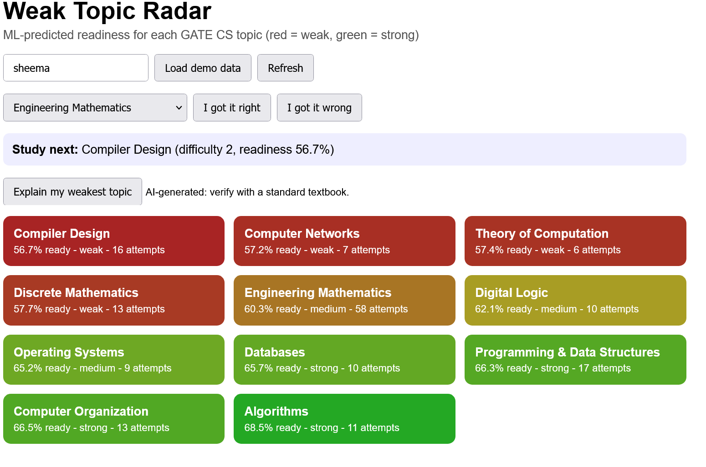
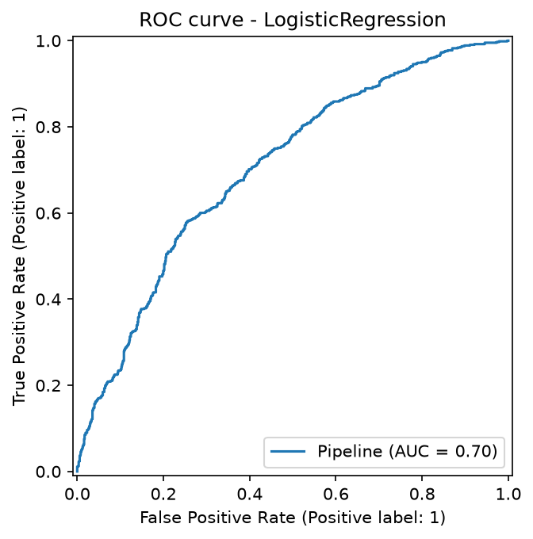
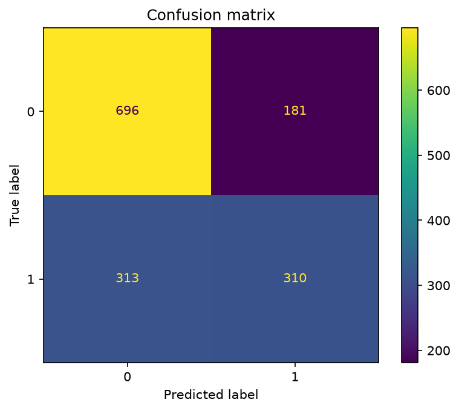

# Exmentify-ML: Weak-Topic Radar

An ML-powered study coach for GATE CS aspirants. A trained model predicts which of the 11 GATE CS subjects a learner is weakest in, and an AI tutor (LangChain + Google Gemini) explains exactly that topic and sets practice questions.

Final project for the **AICTE | IBM SkillsBuild | Machine Learning & Applied AI Internship 2026 (BharatCares)**.
Goal addressed: **SDG 4, Quality Education**.

- **Live demo:** https://exmentify-ml.onrender.com/ml/dashboard
- **API docs (Swagger):** https://exmentify-ml.onrender.com/docs

> The demo runs on a free Render instance. If it has been idle, the first load can take about 50 seconds. Click **Load demo data** on the dashboard to see the heatmap filled in.



## The problem

GATE CS is a highly competitive exam, and many aspirants prepare on their own because coaching is costly or unavailable in their city. Study material is scattered across videos, PDFs and test series, so learners cannot tell which topic needs work next, and nothing warns them when a once-strong topic is going stale.

## What it does

- **Weak-Topic Radar:** a heatmap of predicted readiness for each GATE CS topic (red = weakest, green = strongest).
- **Study next:** the weakest topic with a suggested difficulty level.
- **AI tutor:** a short revision and three practice MCQs with reasons for the weakest topic. Output is labelled *AI-generated: verify with a standard textbook*.
- **Learning loop:** marking an answer right or wrong updates the prediction immediately.
- **Reminders:** an n8n workflow calls the API on a schedule and emails the learner a revision and practice MCQs for the weakest topic.

## How the machine learning works

| Item | Detail |
|---|---|
| Task | Predict the probability that the next answer on a topic is correct (the topic's *readiness*) |
| Data | 7,500 **simulated** attempts from 250 learners across 11 topics (`ml/generate_data.py`) |
| Simulation | Hidden skill per topic, difficulty effect, forgetting over time, random noise |
| Features | topic (one-hot), difficulty (1 to 3), past accuracy, time taken, days since last practice |
| Models compared | Logistic regression and gradient boosting, 80/20 stratified split |
| Selected | Logistic regression (higher ROC-AUC) |

**Results on the held-out test set (1,500 attempts):**

| Metric | Value |
|---|---|
| ROC-AUC | 0.70 (0.705 in the training log) |
| Accuracy | about 67% (1,006 of 1,500 correct) |
| Precision / recall for correct answers | 0.63 / 0.50 |
| Recall for incorrect answers | 0.79 |




The metrics describe the simulation, not real learners. The app relies on the **ranking of topics** per learner rather than on predicting any single answer.

In the app, readiness is predicted for all 11 topics and ranked. The lowest four are flagged weak, the next three medium and the rest strong (a relative ranking). Weaker topics get an easier suggested difficulty.

## Architecture

```
Browser dashboard (HTML/CSS/JS)
        |
        v
FastAPI service (ml_app.py, ml/api.py)  --->  scikit-learn model (joblib)
        |                                      per-learner history (JSON file)
        +--->  LangChain prompt chain  --->  Google Gemini

n8n workflow: Schedule Trigger -> HTTP Request (/ml/explain) -> Markdown to HTML -> Send Email
```

Hosted on Render.

## API endpoints

| Method | Path | Purpose |
|---|---|---|
| GET | `/ml/topics` | List the 11 topics |
| POST | `/ml/attempt` | Record a right or wrong answer |
| GET | `/ml/weak-topics/{user}` | Readiness for every topic, ranked weakest first |
| GET | `/ml/next-question/{user}` | Weakest topic and suggested difficulty |
| GET | `/ml/explain/{user}` | Revision and practice MCQs for the weakest topic (LangChain + Gemini) |
| POST | `/ml/demo-seed/{user}` | Load demo attempts for a user |
| GET | `/ml/dashboard` | The dashboard page |

## Run locally

```bash
git clone https://github.com/sheemashariq1/exmentify-ml.git
cd exmentify-ml
python -m venv venv
# Windows: venv\Scripts\activate      macOS/Linux: source venv/bin/activate
pip install -r requirements.txt

cp .env.example .env        # then add your Gemini key and model name
python ml/generate_data.py  # creates data/attempts.csv
python ml/train.py          # trains and saves models/weak_topic_model.joblib
python -m uvicorn ml_app:app --reload
```

Open http://127.0.0.1:8000/ml/dashboard. Without `GEMINI_API_KEY` and `GEMINI_MODEL`, everything works except `/ml/explain`, which returns an error message.

## Deploy on Render

- Runtime: Python 3
- Build command: `pip install -r requirements.txt && python ml/generate_data.py && python ml/train.py`
- Start command: `python -m uvicorn ml_app:app --host 0.0.0.0 --port $PORT`
- Environment variables: `GEMINI_API_KEY`, `GEMINI_MODEL`, `PYTHON_VERSION`

The build step retrains the model on the server, so the saved model always matches the installed scikit-learn version.

## Project structure

```
exmentify-ml/
├── ml/
│   ├── generate_data.py   # simulated attempt data
│   ├── train.py           # trains, compares and saves the model
│   ├── predictor.py       # readiness, ranking, study-next logic
│   ├── explain.py         # LangChain + Gemini tutor chain
│   └── api.py             # FastAPI router
├── ml_app.py              # FastAPI entry point
├── frontend/ml_dashboard.html
├── data/attempts.csv
├── models/                # saved model and metrics.json
├── docs/                  # charts, screenshots, exported n8n workflow
├── legacy-base-app/       # earlier Exmentify study app, kept for context (not used by the live demo)
├── requirements.txt
└── .env.example
```

## Limitations

- The model is trained on simulated data and must be retrained on real learner attempts before any claim about learning outcomes.
- AI-generated questions can be wrong or poorly framed. They are labelled for verification, and an expert-reviewed question bank is planned.
- Learner history is kept in a JSON file that resets on redeploy; a database is planned.
- The free hosting tier sleeps when idle.

## Future scope

- Retrain on real learner data and compare knowledge-tracing models; explore reinforcement learning for question selection.
- Expert-reviewed question bank with answer verification.
- WhatsApp reminders alongside the existing n8n email reminders.
- Persistent database, login and progress history; regional-language support.
- More exams: UGC NET CS, campus placements and CAT.

## Background

The ML components (data generation, model, API endpoints, dashboard, LangChain tutor and n8n workflow) were built for this internship. The folder `legacy-base-app/` contains the author's earlier Exmentify study-app code, kept for context. It is not part of the ML service described above and is not what the live demo runs.

## Author

Sheema Shariq, B.Sc. (Hons.) Computer Science, Jamia Millia Islamia
Internship ID: IBMUEML001308